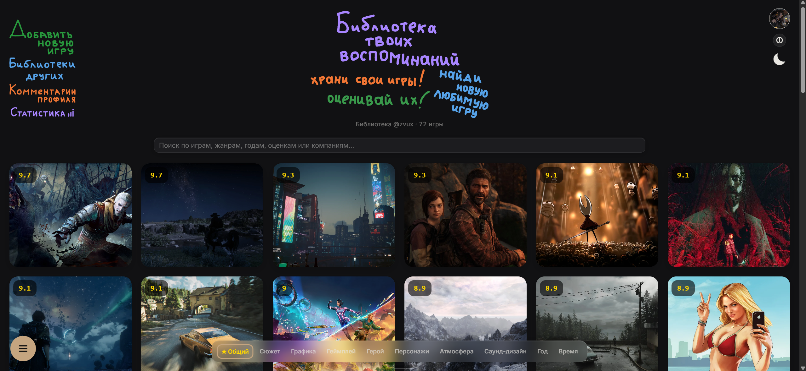
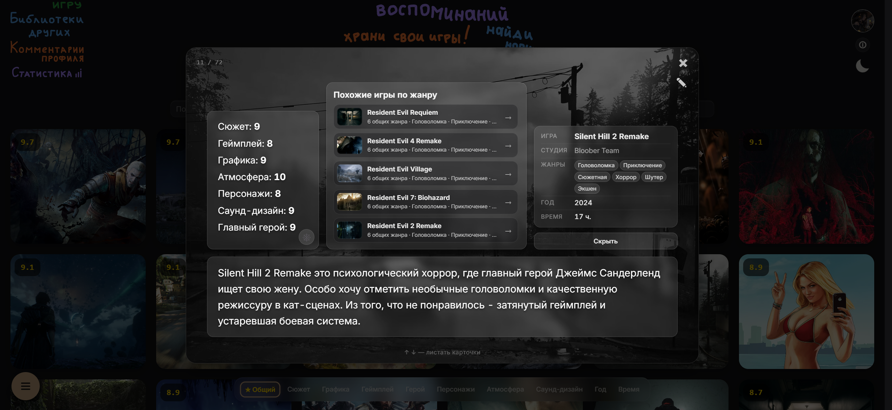
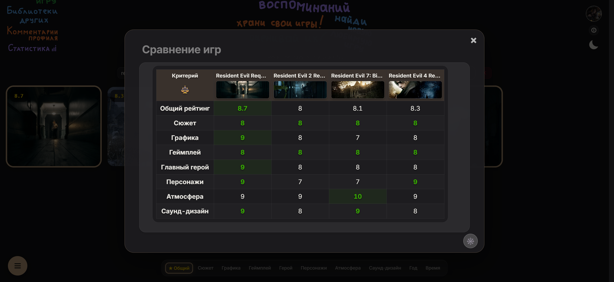
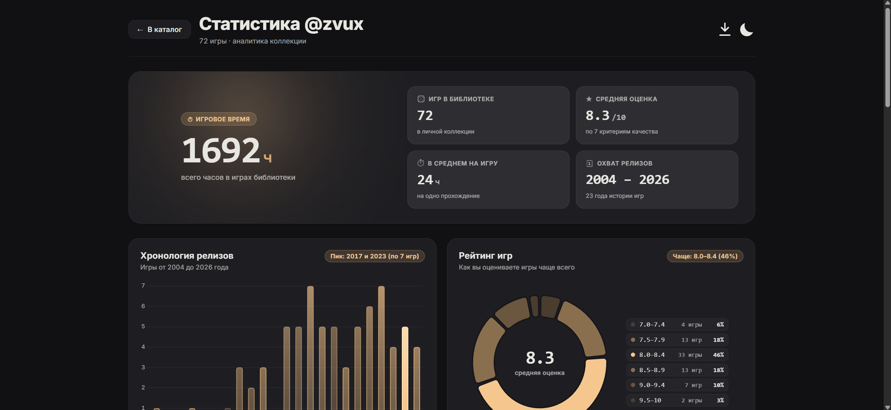
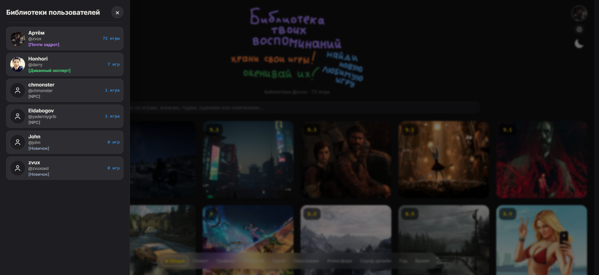
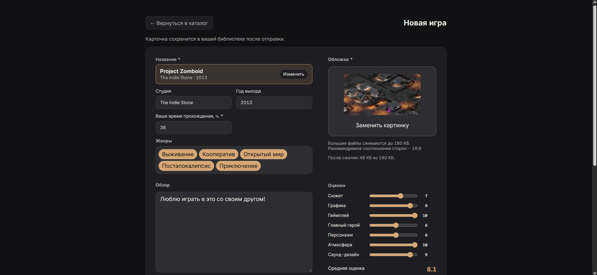

<div align="center">


# Zvux Good Games

**Библиотека твоих игровых воспоминаний — персональный каталог видеоигр с детальной системой оценок, глубокой аналитикой, умным поиском и социальными функциями.**

[](https://zvuxgg.ru/)
[](https://react.dev/)
[](https://vite.dev/)
[](https://supabase.com/)
[](https://www.chartjs.org/)

</div>

---

<div align="center">
  
</div>

---

## О проекте

**Zvux Good Games** — веб-приложение для ведения личной коллекции пройденных игр, созданное для тех, кто хочет не просто ставить оценку «из 10», а сохранять развёрнутые впечатления по ключевым аспектам каждой игры, сравнивать тайтлы между собой, исследовать библиотеки других игроков и наглядно видеть свой игровой вкус на графиках.

---

## Ключевые возможности

### 1. Персональный каталог и два вида отображения
* **Сетка (`grid`, по умолчанию)** — компактная витрина обложек с бейджем текущего критерия сортировки и плавным появлением названия при наведении.
* **Список (`list`)** — широкоформатные карточки с `3D-tilt` эффектом при движении курсора, всплывающими оценками по всем 7 критериям и тегами жанров.
* **Индивидуальное кадрирование обложек** — для каждой карточки отдельно настраиваются координаты (`X / Y`) и масштаб (`100%–200%`) как для списка, так и для сетки.
* **Сортировка в 1 клик** — плавающий нижний док (`Sort Dock`) сортирует библиотеку по общему рейтингу, любому из 7 критериев, году выхода или времени прохождения.

<div align="center">
  
</div>

---

### 2. Система оценивания по 7 критериям
Каждая игра оценивается по шкале от `1` до `10` по семи параметрам:
1. **Сюжет**
2. **Графика**
3. **Геймплей**
4. **Главный герой**
5. **Персонажи**
6. **Атмосфера**
7. **Саунд-дизайн**

Итоговый балл рассчитывается автоматически как среднее арифметическое с округлением до десятых. В карточке игры оценки можно переключать между текстовым списком и **лепестковой диаграммой (Radar Chart)**.

---

### 3. Умный комбинированный поиск и фильтрация
Поисковая строка понимает сложные комбинированные запросы на русском и английском языках:
* **Префиксный поиск и алиасы (`game-aliases.js`)** — находит игры по началу любого слова, популярным аббревиатурам и русским названиям (`ведьмак`, `gta`, `rdr`, `bg3`, `cp2077`, `kcd`, `tlou`, `gow`, `dmc`, `mgs`, `фоллаут`, `ассасин` и др.).
* **Фильтры по году выхода** — точный год (`2020`), игры новее (`2018+`) или старше (`2015-`).
* **Фильтры по рейтингу** — от заданного балла (`8.5+`) или до него (`7.5-`).
* **Включение и исключение жанров** — текстовые токены (`хоррор`, `рпг`) и исключения через минус (`-инди`, `-хоррор`).
* **Пример реального запроса**: `capcom хоррор 8.1+ 2017+ -инди`
* **Панель 22 жанров** — интерактивный фильтр с поддержкой мультивыбора: `ЛКМ` включает жанр (`✓`), `ПКМ` или двойной клик/тап исключает его (`−`).

---

### 4. Сравнение игр и рулетка «Во что сыграть?»
* **Режим сравнения** — вызывается долгим нажатием на карточку или через меню быстрых действий (`Speed Dial`). Позволяет сопоставить несколько игр:
  * в **табличном виде** с автоматической подсветкой лучших показателей в каждой строке;
  * на **общей Radar-паутинке**, где можно включать и скрывать отдельные игры с плавной анимацией прозрачности.
* **Рулетка «Во что сыграть?»** — анимированная лента выбора случайной игры из библиотеки с плавным замедлением и автоматическим переходом к карточке победителя.
* **Подбор похожих игр** — внутри каждой карточки рассчитываются топ-5 близких игр коллекции на основе пересечения жанров и коэффициента Жаккара.

<div align="center">
  
</div>

---

### 5. Страница аналитики и игровой портрет (`/stats`)
Отдельная страница глубокой статистики коллекции (доступна для своего и любого публичного профиля):
* **Hero-дашборд** — общее игровое время (с переводом в полные сутки), количество тайтлов, средний балл, охват годов релизов и спарклайн активности.
* **Динамический «Игровой портрет»** — автоматическая генерация архетипа игрока на основе его любимых жанров, самых строгих/высоких критериев и стажа (*«Атмосферный сюжетоман»*, *«Страшный любитель музыки»*, *«Хранитель летописей»*, *«Эстет пикселей»*, *«Неоновый визионер»* и др.).
* **Постер для соцсетей (`1200×1500 px`)** — встроенный генератор карточки на `Canvas API` по скачиванию в `PNG`.
* **Набор интерактивных диаграмм**:
  * Пончик распределения оценок по диапазонам (`Donut Chart`);
  * Точечный график оценок по годам выхода с линией тренда (`Scatter Plot`);
  * График самых длинных игр по времени прохождения (`Lollipop Chart`);
  * Рейтинг любимых жанров;
  * Дивергентная диаграмма отклонения каждого из 7 критериев от среднего балла (`Divergent Bar Chart`);
  * **Топ студий-разработчиков** (сортировка по среднему баллу или числу игр, отображение главного шедевра студии и ключевых жанров).

<div align="center">
  
</div>

---

### 6. Социальные функции и титулы игроков
* **Публичные библиотеки** — выезжающая панель со списком пользователей, отсортированным по размеру коллекции.
* **Система ранговых титулов** — под никнеймом каждого игрока отображается цветной титул в зависимости от числа оценённых игр:
  * `0` — `[Новичок]`
  * `1–4` — `[NPC]`
  * `5–14` — `[Диванный эксперт]`
  * `15–29` — `[Бывалый игрок]`
  * `30–49` — `[Опытный геймер]`
  * `50–99` — `[Почти задрот]`
  * `100–150` — `[Ветеран геймдева]`
  * `151+` — `[Щупал траву в 2012-м]`
* **Комментарии к профилю с упоминаниями игр** — в гостевой книге любого профиля можно упомянуть игру через `@Название игры`, и текст автоматически превратится в интерактивную ссылку, открывающую карточку этой игры.

<div align="center">
  
</div>

---

### 7. Добавление игр, единый справочник и модерация
* **Единый каталог (`public.game_catalog`)** — при добавлении игры (`/add-game`) название выбирается через быстрый автокомплит из проверенной базы (`data/games.json`), после чего студия, год выхода и канонические жанры подставляются автоматически.
* **Контроль дубликатов** — поиск мгновенно предупреждает, если выбранная игра уже есть в библиотеке пользователя.
* **Клиентское сжатие обложек** — загружаемые обложки автоматически конвертируются в `WebP` и сжимаются в браузере, а показ изображений ускоряется двухуровневым кэшем (`Memory + IndexedDB`).
* **Личный кабинет заявок (`/submissions`)** — история отправленных карточек без дубликатов, разбитая на 3 группы (*«Принятые»*, *«На проверке»*, *«Отклонённые»*), с возможностью отменить заявку, удалить её из истории или отредактировать отклонённую карточку с учётом комментария модератора.
* **Панель модератора (`/moderation`)** — защищённая `RLS` и `RPC`-функциями очередь проверки новых карточек и изменений.

<div align="center">
  
</div>

---

### 8. Адаптивность (Mobile → 2K → 4K) и темы оформления
* **Две полноценные темы** — тёмная (`#111113`) и светлая (`blanchedalmond`) с плавным переключателем `Sun/Moon`.
* **Отдельный мобильный UX (`<= 640px`)** — полноценные страницы игр с поддержкой `History API` (`?game=ID`), мобильные ползунки позиционирования обложек по осям `X / Y` и кнопка циклического масштаба `+25%`.
* **Масштабирование под 4K (`3840×2160`)** — автоматический пропорциональный скейлинг интерфейса на экранах `> 2560px`, сохраняющий эталонные пропорции `2K`.

---

## Горячие клавиши

| Клавиша | Действие |
| :--- | :--- |
| `/` или `.` | Фокус в строку умного поиска |
| `V` (лат.) / `М` (рус.) | Переключение вида каталога: **Сетка** ↔ **Список** |
| `F` (лат.) / `А` (рус.) | Открыть / закрыть панель фильтрации по жанрам |
| `↑` / `↓` | Листать игры внутри открытого модального окна карточки |
| `←` `→` `↑` `↓` | Навигация фокусом между карточками каталога |
| `Escape` | Закрыть открытое модальное окно, панель или сбросить поиск |

---

## Технологический стек

* **Frontend**: React 18, Framer Motion (layout & spring-анимации), Chart.js (Radar, Donut, Scatter, Lollipop), нативный Canvas API.
* **Сборка**: Vite 6 (многостраничная конфигурация с чистыми маршрутами без `.html` и разбивкой вендорных чанков).
* **Backend & BaaS**: Supabase (PostgreSQL, Row Level Security, Auth, Storage-бакеты `game-covers` и `profile-avatars` с подписанными URL и хранимыми `RPC`-процедурами).
* **Кэширование**: `IndexedDB` + `sessionStorage` + `localStorage` (`stale-while-revalidate` для профилей, аватаров и обложек).

---

## Структура проекта

```text
├── data/
│   ├── screenshots/             # Скриншоты для README     
│   └── games.json               # Единый версионируемый справочник игр (источник для импорта)
├── moderation/
│   ├── index.html               # Точка входа панели модерации (/moderation)
│   ├── moderation.js            # Логика очереди модерации заявок
│   └── moderation.css           # Стили панели модерации
├── favicons/                    # Иконки приложения и манифест
├── svg/                         # Векторная графика шапки и навигации
├── scripts/
│   └── import-games.mjs         # CLI-скрипт валидации и синхронизации games.json с Supabase
├── supabase/
│   └── migrations/              # SQL-миграции схемы БД, триггеров, RPC и политик RLS
├── index.html                   # Главная страница каталога (/)
├── add-game.html                # Страница добавления и редактирования игры (/add-game)
├── stats.html                   # Страница статистики и аналитики (/stats)
├── submissions.html             # Страница истории заявок пользователя (/submissions)
├── app.jsx                      # Основное приложение и UI-компоненты
├── game-aliases.js              # Индекс синонимов, аббревиатур и префиксного поиска игр
├── genres.js                    # Канонические 22 жанра и словарь их синонимов
├── game-submission.js           # Клиентская подготовка обложек и отправка карточек
├── cover-cache.js               # Кэширование обложек и signed URL в IndexedDB
├── style.css                    # Стили приложения, темы и адаптивная вёрстка (Mobile — 4K)
└── vite.config.js               # Конфигурация сборщика и чистых маршрутов
```

---

## Локальный запуск и разработка

### 1. Установка зависимостей
```bash
npm install
```

### 2. Настройка подключения к Supabase
Проверьте конфигурацию публичного URL и `publishableKey` в файле `supabase-config.js`, а также примените SQL-миграции из папки `supabase/migrations/` в вашем проекте Supabase.

Для работы CLI-импортёра справочника игр создайте локальный файл `.env` (по образцу `.env.example`):
```env
SUPABASE_URL=https://your-project-id.supabase.co
SUPABASE_SERVICE_ROLE_KEY=your-service-role-key
```

### 3. Запуск dev-сервера
```bash
npm run dev
```

### 4. Работа со справочником игр (`data/games.json`)
```bash
# Проверка валидности всех игр и жанров без записи в БД (dry-run)
npm run import:games:dry

# Импорт и синхронизация справочника игр с базой Supabase
npm run import:games
```

### 5. Сборка для продакшена
```bash
npm run build
npm run preview
```
Готовая оптимизированная сборка формируется в директории `dist/`.

---

## Автор и обратная связь

Разработка и идея: Телеграм - **[@zvuxoed](https://t.me/zvuxoed)**  

